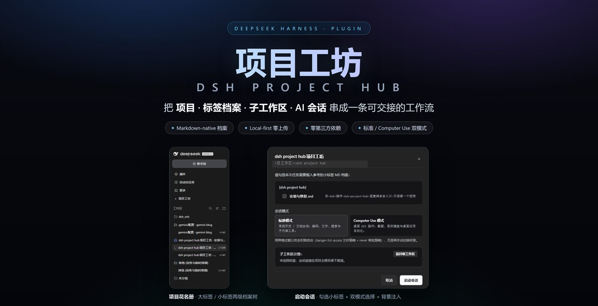
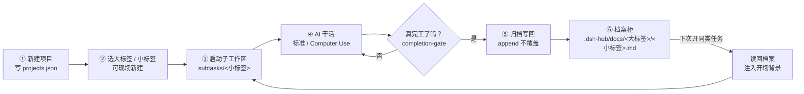
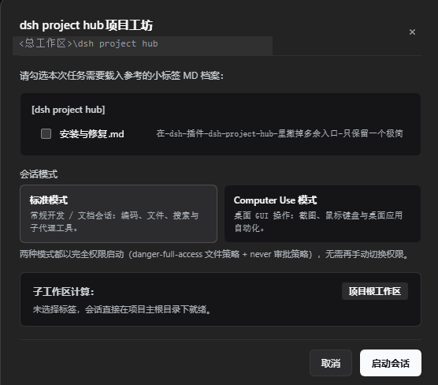
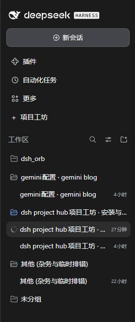
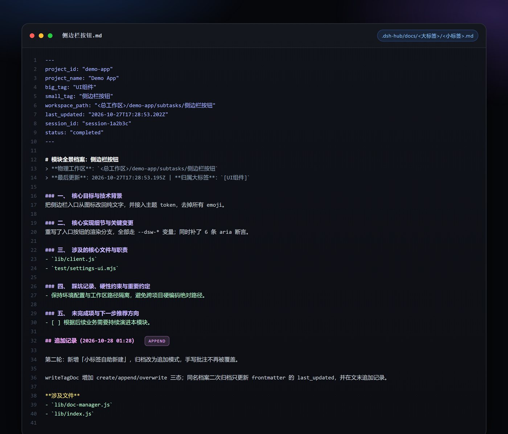

<div align="center">

# 项目工坊 · DSH Project Hub

**把「项目 · 标签档案 · 子工作区 · AI 会话」串成一条可交接的工作流。**

*Projects, tag archives, isolated sub-workspaces and AI sessions — handover-ready.*

[](./LICENSE)
[](./package.json)
[](README.md#sec-install)
[](README.md#sec-roadmap)
[](./package.json)
[](https://github.com/systemsssx/dsh-project-hub/stargazers)
[](https://github.com/systemsssx/dsh-project-hub/issues)
[](https://github.com/systemsssx/dsh-project-hub/discussions)



</div>

> **一句话定位**：给 DeepSeek Harness 加一个"项目工坊"侧边栏——项目登记、两级标签档案、隔离子工作区、归档与背景注入，全部落在本机 Markdown 里。

---

## 📖 目录

- [它是什么](#sec-what)
- [它解决什么问题](#sec-why)
- [功能矩阵](#sec-features)
- [工作流](#sec-flow)
- [界面预览](#sec-shots)
- [快速开始](#sec-install)
- [Computer Use 模式](#sec-computer-use)
- [档案格式](#sec-archive)
- [测试与文档](#sec-tests)
- [常见问题](#sec-faq)
- [路线图](#sec-roadmap)
- [Star 支持](#sec-star)
- [交流与反馈](#sec-community)
- [贡献](#sec-contributing)
- [License](#sec-license)

---

<a id="sec-what"></a>

## ✨ 它是什么

**DSH Project Hub（项目工坊）是 [DeepSeek Harness](https://github.com/deepseek-ai) 的一个侧边栏插件。**

它把原本"聊完就散"的 AI 编程会话，收进一套**有结构、可交接**的工作流：项目有花名册，模块有大/小两级档案，任务落在隔离子工作区，干完的活写回档案，下次开工自动带上前情提要。

所有数据都是你本机的 Markdown / JSON 文件——没有数据库、没有云端、没有账号。

<div align="center">
<sub>🧩 插件本体零第三方依赖 · 🖥️ 桌面壳 + 普通 Web 模式通用 · 🔒 不联网、不上传</sub>
</div>

---

<a id="sec-why"></a>

## 🎯 它解决什么问题

AI 会忘事，而项目不会。真正贵的是"重新讲一遍这个项目做到哪了"。

| 场景 | 手工维护（没有插件） | 用项目工坊 |
|---|---|---|
| 🗂️ 项目太多 | 文件夹散落各处，哪个做到哪全靠记忆 | 一个总工作区 + 项目花名册，侧栏一眼看完 |
| 🧠 AI 失忆 | 每次开新会话都要重新贴背景、解释上下文 | 档案自动注入开场 Prompt，AI 睁眼就知道前情 |
| 🔁 知识流失 | 这次聊透的方案，下次换个会话就没了 | 归档写回 `.md` 档案，追加不覆盖，永久可查 |

> 一句话：**上一次会话的结论，是下一次会话的起点。**

---

<a id="sec-features"></a>

## 🧩 功能矩阵

| | 能力 | 一句话说明 |
|---|---|---|
| 📇 | **项目花名册** | 登记 id / 名称 / 默认大标签，自动建目录与 `projects.json`，已存在目录会自动播种 |
| 🗄️ | **两级标签档案柜** | `docs/<大标签>/<小标签>.md`，YAML frontmatter + 五段式正文，人类可读、Git 可 diff |
| 🌿 | **三层子工作区** | 0 标签 → 项目根；1 标签 → `subtasks/<标签>`；多标签 → `subtasks/combo-*`，cwd 即上下文边界 |
| 💉 | **背景注入** | 启动会话时读回同类档案，拼成开场背景注入新会话，不用再手贴上下文 |
| 🔁 | **归档闭环** | 手动勾选历史会话归档，或让 AI 调用 `record_module_done` 工具自动写回 |
| 🆕 | **小标签自助新建** | 在「启动会话」下拉底部直接「＋ 新建小标签」，当场建档，不用先碰文件系统 |
| ➕ | **归档追加不覆盖** | 同名档案二次归档保留全文，只更新 `last_updated` 并追加一节 `## 追加记录` |
| ↻ | **列表实时刷新** | 新建项目 / 新建标签 / 归档后自动重读，也可手动「↻ 刷新」，无需重启 DSH |
| 🖥️ | **标准 / Computer Use 双模式** | 同一入口选择编码 Agent 或能看屏幕、动鼠标的 GUI Agent（见 [Computer Use 模式](#sec-computer-use)） |
| ⚙️ | **总工作区热切换** | 抽屉底部「设置」改根目录，校验后即时生效并持久化；非法路径不改任何状态 |

---

<a id="sec-flow"></a>

## 🔄 工作流



> `record_module_done` 不是"模型说了算"：只有本轮正常结束、且确实写过文件或跑过命令，才允许写档案。

---

<a id="sec-shots"></a>

## 📸 界面预览

<div align="center">
  
  <br />
  <sub><b>① 启动会话</b>：勾选要注入的档案、选择「标准 / Computer Use」模式，插件自动计算子工作区并注入背景</sub>
</div>

<br />

<div align="center">
  
</div>

<div align="center"><sub><b>② 工作区花名册</b>：按「大标签 · 小标签」两级展开，右侧显示档案数与最近更新时间</sub></div>

<br />

<div align="center">
  
  <br />
  <sub><b>③ 档案即知识库</b>：frontmatter 给机器读，正文给人读；追加模式下只变更 <code>last_updated</code> 并追加记录</sub>
</div>

---

<a id="sec-install"></a>

## 🚀 快速开始

### 前置条件

| 依赖 | 要求 |
|---|---|
| DeepSeek Harness | 桌面版（Electron），带 `webServer` / `tools` / `agentPresets` 扩展点 |
| Node.js | **>= 18**（插件为纯 ESM，无第三方依赖） |
| 操作系统 | Windows / macOS / Linux |
| 权限 | 可读写 `~/.dsh/`（Windows：`%USERPROFILE%\.dsh\`） |

### 1 · 放进插件目录

```bash
# macOS / Linux
git clone https://github.com/systemsssx/dsh-project-hub.git ~/.dsh/plugins/dsh-project-hub

# Windows (PowerShell)
git clone https://github.com/systemsssx/dsh-project-hub.git "$env:USERPROFILE\.dsh\plugins\dsh-project-hub"
```

目录名必须叫 `dsh-project-hub`（与 `package.json` 的 `name` 一致）。

### 2 · 装配到 profile

编辑 `~/.dsh/profiles/desktop/package.json`，把它加进 `bundles` 与 `dependencies`：

```jsonc
{
  "dsh": {
    "profile": {
      "bundles": [
        "@deepseek-ai/dsh-base",
        "@deepseek-ai/dsh-web-app",
        "dsh-project-hub"            // ← 新增
      ],
      "patchReload": "live"
    }
  },
  "dependencies": {
    "dsh-project-hub": "link:C:/Users/<you>/.dsh/plugins/dsh-project-hub"
  }
}
```

### 3 · 设置总工作区

打开插件自带的 `cordis.patch.yml`，把 `globalWorkspaceRoot` 改成你自己的绝对路径：

```yaml
- insert:
    - id: project-hub
      name: 'dsh-project-hub'
      config:
        enabled: true
        globalWorkspaceRoot: 'C:\work'   # ← 改成你的目录，例如 D:\projects
```

> 也可以用环境变量 `DSH_PROJECT_HUB_ROOT` 兜底；装好后还能在插件「设置」里随时热切换。

### 4 · 重启并打开

1. 重启 DSH（或等 profile 热重载完成）；
2. 左侧边栏出现「**＋ 项目工坊**」；
3. 点开抽屉 → 底部「设置」确认总工作区 → `＋ 新建项目` 开始第一个项目。

---

<a id="sec-computer-use"></a>

## 🖥️ Computer Use 模式

「启动会话」里的第二个模式：让 AI **看着界面操作电脑**——截图、移动鼠标、点击、键盘输入。

### 它会做什么

- 在全新会话中启动一个 GUI 驱动型 Agent（preset `computer-use`），cwd 仍钉在子工作区；
- 允许 Agent 截屏、模拟鼠标键盘、操作前台应用，适合"打开应用点一遍验证 UI"这类任务。

### 前置条件与权限说明

| 项 | 说明 |
|---|---|
| 运行环境 | **需要 DSH 桌面版**（Electron 壳 + 真实 GUI）；无头环境不可用 |
| 额外 bundle | 需要 profile 里装配了能提供 `computer-use` Agent preset 的 bundle（例如 `dsh-orb`）。**缺失时该模式自动从下拉里隐藏**，只留「标准模式」，不报错、不崩 UI |
| 权限策略 | 从项目工坊启动的会话固定使用**完全权限**：`sandbox: danger-full-access` + `approval: never` |
| 这意味着 | AI 可以读写本机任意文件、执行命令、控制鼠标键盘——只在信任当前任务时使用 |
| 建议 | 纯代码任务选「标准模式」；到 DSH「设置 → 权限」确认默认 preset 符合预期 |
| 第三方安装 | 插件自身零依赖、不联网；Computer Use 的能力来自宿主 bundle，不随插件打包，别人装了也能跑（但同样需要那个 bundle） |

> ⚠️ Computer Use 会把屏幕内容交给模型。处理密码、私密窗口前请先切走或关闭。

---

<a id="sec-archive"></a>

## 🗄️ 档案格式

```text
<总工作区>/
├─ .dsh-hub/
│  └─ projects.json                 # 项目花名册
└─ my-project/
   ├─ .dsh-hub/docs/
   │  ├─ UI组件/
   │  │  ├─ 侧边栏按钮.md            # 一份模块档案 = 一个小标签
   │  │  └─ 设置弹窗.md
   │  └─ Core算法/
   │     └─ 渲染管线.md
   └─ subtasks/
      ├─ 侧边栏按钮/                  # 单标签子工作区
      └─ combo-设置弹窗-主题/         # 多标签复合子工作区
```

frontmatter 是**给机器读的索引**（`project_id` / `big_tag` / `small_tag` / `workspace_path` / `last_updated` / `session_id` / `status`），
正文固定五段：核心目标 / 实现细节 / 涉及文件 / 验证方式 / 下一步。

```markdown
---
project_id: "my-project"
big_tag: "UI组件"
small_tag: "侧边栏按钮"
workspace_path: "<总工作区>/my-project/subtasks/侧边栏按钮"
last_updated: "2026-10-28T01:28:53.202Z"
status: "completed"
---

# 模块全景档案：侧边栏按钮
### 一、核心目标与技术背景
### 二、核心实现细节与关键变更
### 三、涉及文件与交付物
### 四、踩坑记录与重要约定
### 五、未完成项与下一步

## 追加记录（2026-10-28 09:28）
（append 模式只往文末补这一节，手写正文原样保留）
```

---

<a id="sec-tests"></a>

## 🧪 测试与文档

```bash
npm test        # node --test test/*.mjs —— 当前 91 个用例全绿
npm run check   # 四个 lib 文件语法自检
```

| 文档 / 测试 | 内容 |
|---|---|
| [`docs/architecture.md`](./docs/architecture.md) | 架构与设计取舍：两半结构、8 条路由、数据契约、追加语义、模式接线 |
| [`CONTRIBUTING.md`](./CONTRIBUTING.md) | 提 Issue / PR 的流程、代码风格、测试要求 |
| `test/run.mjs` | 花名册、三层工作区、档案读写、追加不覆盖、completion-gate |
| `test/integration.mjs` | 宿主路由、总工作区切换、CORS/PNA 预检、绝对 http(s) 基址 |
| `test/ingest-*.mjs` / `test/settings-*.mjs` | 归档表单、标签下拉、新建小标签、设置弹窗 |
| `test/theme-tokens.mjs` | 每个 `--dsw-*` 主题变量对照 app.asar 扫描清单校验 |

测试数据只写在 `test/.tmp-*`，**不会碰你的真实总工作区**。

---

<a id="sec-faq"></a>

## ❓ 常见问题

<details>
<summary><b>装好后侧边栏没有「＋ 项目工坊」？</b></summary>

1. 确认 profile 的 `bundles` 里有 `dsh-project-hub`、`dependencies` 里有对应的 `link:`；
2. 确认 `~/.dsh/plugins/dsh-project-hub/package.json` 存在且目录名正确；
3. 完全重启 DSH（或触发 profile 重载）。
</details>

<details>
<summary><b>点「启动会话」没反应 / 报 404？</b></summary>

插件所有请求都走宿主的本地 HTTP 路由。先重启一次；仍不行就打开开发者工具看 `/project-hub/state` 是否 200。
若你是自建 `dsh web` 反向代理，请保证页面与 Host 同源，或保留 `__DSH_TRANSPORT__.streamBaseUrl` 注入。
</details>

<details>
<summary><b>模式下拉里只有「标准模式」？</b></summary>

说明当前 profile 没有提供 `computer-use` preset 的 bundle（如 `dsh-orb`）。这是预期降级：装上层 bundle 后重启即可出现。
</details>

<details>
<summary><b>归档会不会覆盖我手写的档案内容？</b></summary>

不会。默认 `append`：只更新 frontmatter 的 `last_updated`，在文末追加 `## 追加记录（时间）`，正文一字不动。
只有显式传 `mode: 'overwrite'` 才会重写（插件 UI 不会这么做）。
</details>

<details>
<summary><b>config.json 在哪？会被提交到 Git 吗？</b></summary>

`<插件目录>/config.json`，只存总工作区路径，保存设置时才生成。它已在 `.gitignore` 里，不会入库。
优先级：`cordis.patch.yml` → `DSH_PROJECT_HUB_ROOT` → `C:\work`；「设置」里保存过的值优先级最高。
</details>

<details>
<summary><b>把项目「移出列表」会删我文件吗？</b></summary>

不会。只从 `projects.json` 移除记录，项目目录、档案、子工作区全部原样保留，随时可重新登记。
</details>

<details>
<summary><b>支持 macOS / Linux 吗？</b></summary>

支持。所有路径都走 `node:path`，只是默认示例路径是 Windows 风格，首装记得把总工作区改成你自己的绝对路径。
</details>

---

<a id="sec-roadmap"></a>

## 🗺️ 路线图 · Roadmap

- [ ] 📤 **档案导出**：把某个大标签下的全部档案导出成单文件 HTML/PDF 交接手册
- [ ] 🧭 **任务看板**：小标签升级成卡片，支持「待办 / 进行中 / 已完成」
- [ ] 🔎 **全局搜索**：跨项目、跨标签全文检索档案
- [ ] 🌐 **多语言界面**：`zh-CN` / `en-US` 文案包
- [ ] 🧩 **会话交接联动**：把会话交接 / 上下文压缩类插件的产物直接落进对应小标签档案

---

<a id="sec-star"></a>

## ⭐ Star 支持

<div align="center">

**如果这个插件帮你省下了"重新解释一遍项目"的时间——**

**点个 ⭐ Star，就是继续做下去最直接的动力。**

[](https://github.com/systemsssx/dsh-project-hub/stargazers)
&nbsp;
[](https://github.com/systemsssx/dsh-project-hub/fork)

<sub>Fork 之后欢迎把改动推回来：错别字、新策略、真机踩坑都收。</sub>

</div>

---

<a id="sec-community"></a>

## 💬 交流与反馈

| 我想… | 去哪儿 | 请带上 |
|---|---|---|
| ❓ 提问 / 讨论用法 / 分享配置 | **[Discussions](https://github.com/systemsssx/dsh-project-hub/discussions)** | 你的工作流截图（记得脱敏） |
| 🐛 报 Bug | **[Issues · Bug](https://github.com/systemsssx/dsh-project-hub/issues/new?template=bug_report.md)** | DSH 版本、OS、复现步骤、期望 vs 实际、报错日志 |
| 💡 提需求 | **[Issues · Feature](https://github.com/systemsssx/dsh-project-hub/issues/new?template=feature_request.md)** | 使用场景 + 现在卡在哪 |
| 🛠️ 提 PR | **[Pull Request](https://github.com/systemsssx/dsh-project-hub/compare)** | 改动说明 + `npm test` 输出 |

> **有小问题先去 Discussions**（Q&A 分类），确认是 Bug 再开 Issue，能少绕一圈。
> 发帖别贴 token / 真实绝对路径 / 用户名，用 `<总工作区>`、`<项目>` 占位。

---

<a id="sec-contributing"></a>

## 🤝 贡献

```bash
git clone https://github.com/systemsssx/dsh-project-hub.git
cd dsh-project-hub
npm test          # 91 用例必须全绿
npm run check
```

- 纯 ESM、零运行时依赖，不新增 `dependencies`；
- 界面只在 `lib/client.js`（`React.createElement`，不写 JSX），磁盘只在宿主侧；
- 档案写入默认 `append`，别悄悄改成覆盖；
- 提交信息用 Conventional Commits（`feat:` / `fix:` / `docs:` / `test:`）。

完整规范见 [`CONTRIBUTING.md`](./CONTRIBUTING.md)。

---

<a id="sec-license"></a>

## 📄 License & 致谢

[MIT License](./LICENSE) © 2026 systemsssx

感谢 [DeepSeek Harness](https://github.com/deepseek-ai) 提供的 Electron 外壳、Cordis 插件管线与 Agent preset 扩展点；
感谢所有在 Discussions 里提过想法、报过 Bug 的人。

<div align="center">
<br />
<sub>Made for people who hand their projects to AI — and to the next human. 🧰</sub>
</div>
