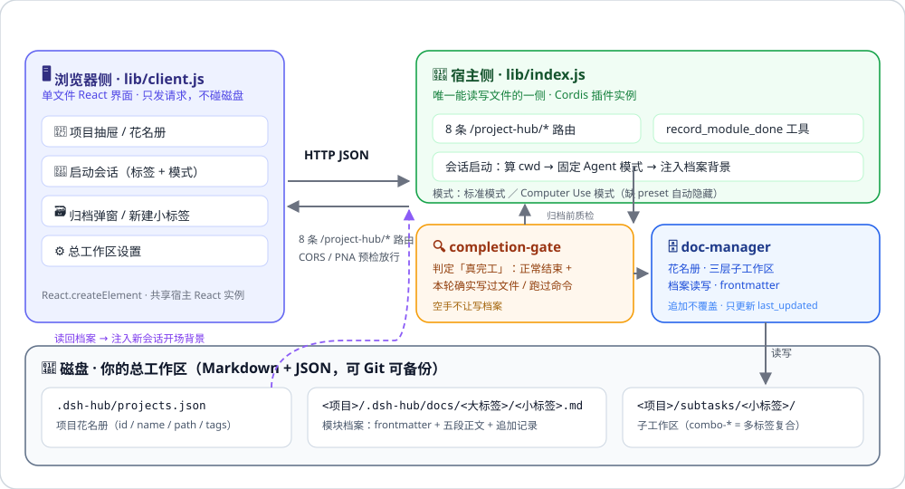

<div align="center">

# 🧰 DSH Project Hub · 项目工坊

**把「项目 · 标签档案 · 子工作区 · AI 会话」串成一条可交接的工作流。**
*One plugin that turns DeepSeek Harness into a handover-ready project workshop.*

[](./LICENSE)
[](./package.json)
[](./README.md#-环境与前置条件)
[](./README.md#-路线图--roadmap)
[](./package.json)
[](https://github.com/systemsssx/dsh-project-hub/stargazers)
[](https://github.com/systemsssx/dsh-project-hub/issues)
[](https://github.com/systemsssx/dsh-project-hub/discussions)

[✨ 它是什么](#-它是什么) · [🚀 功能亮点](#-功能亮点) · [📸 界面预览](#-界面预览) · [⚡ 快速开始](#-安装三段式) · [🧠 Computer Use](#-computer-use-模式) · [🧪 测试](#-测试与文档体系) · [🗺️ 路线图](#-路线图--roadmap) · [💬 交流](#-交流与反馈)

</div>

<p align="center"><sub>为 <a href="https://github.com/systemsssx/dsh-auto-handoff">DSH</a>（DeepSeek Harness）桌面端打造的官方风格社区插件 · v0.2.0</sub></p>

---

## ✨ 它是什么

**DSH Project Hub（项目工坊）是 DeepSeek Harness 的一个侧边栏插件。**

它解决的是一个很具体的问题：AI 编程会话是"一次性"的——关掉窗口，上下文就散了；下一次换个会话，AI 不知道这个项目做到哪、上次那个模块为什么这么改。

项目工坊把散落的会话，收进一套**有结构、可交接**的工作流里：

| 你会得到 | 具体是什么 |
|---|---|
| 🗂️ **项目花名册** | 一个总工作区下的所有项目，一眼可见、可登记、可移出（移出只动注册表，文件不删） |
| 🏷️ **两级标签档案柜** | 「大标签 / 小标签」两层目录，每个模块一份 Markdown 档案，带 YAML frontmatter |
| 🌿 **三层子工作区** | 无标签 → 项目根；单标签 → `subtasks/<小标签>`；多标签 → `subtasks/combo-*`，开工即隔离 |
| 🔁 **归档闭环** | 会话结束写回档案；下次开同类任务，档案自动作为背景注入开场 Prompt |
| 🖥️ **Computer Use 模式** | 一键在新会话里驱动 GUI（截图、鼠标、键盘），适合需要看界面的任务 |

一句话：**让 AI 的每一次干活，都沉淀成下一个 AI 的起点。**（so the next agent starts where the last one stopped.）

---

## 🚀 功能亮点

### 📇 项目登记与花名册
- 「＋ 新建项目」只填三项：项目 id、显示名、默认大标签。
- 自动在总工作区下创建 `<项目>/.dsh-hub/docs/` 与 `<项目>/subtasks/`，并写入花名册 `projects.json`。
- 总工作区首次使用时，自动探测已存在的目录并**播种**成项目，不用逐个手搬。
- 移出列表只改注册表：**磁盘上的项目文件与档案一份不动**，随时可重新登记。

### 🗄️ 大标签 / 小标签档案柜
- 档案路径固定为 `<项目>/.dsh-hub/docs/<大标签>/<小标签>.md`——人类可读、Git 可 diff、AI 可注入。
- 每份档案带机器可读的 **frontmatter**（`project_id` / `big_tag` / `small_tag` / `workspace_path` / `last_updated` / `session_id` / `status`），
  侧边栏的档案计数与排序全靠它。
- 正文采用「核心目标 / 实现细节 / 涉及文件 / 验证方式 / 下一步」五段式模板。

### 🌿 一键开子工作区 + 背景注入
- 「启动会话」里勾选小标签，插件按三层规则算出物理目录，并把 **cwd 直接钉在子工作区**。
- 同时读取该项目已有档案，拼成开场背景注入新会话，AI 睁眼就知道前情提要。
- 会话模式可选：**标准模式** 或 **Computer Use 模式**（见下文）。

### 🔁 归档写回，形成闭环
- **手动归档**：勾选历史会话 → 填写摘要 / 细节 / 涉及文件 → 一键入库。
- **AI 自动归档**：内置 `record_module_done` 工具，AI 干完一个模块即可主动调用；`completion-gate` 会先判定"是否真的完工"（正常结束 + 本轮确实写过文件或跑过命令），防止空手写档案。

### 🆕 本次更新（v0.2.0）
- **小标签自助新建**：不用先去文件系统建目录——「启动会话」的下拉底部就有「＋ 新建小标签」，当场建档并自动勾选。
- **归档追加不覆盖**：同名档案二次归档不再重写正文，而是保留全文、只更新 `last_updated`，并在文末追加一节
  `## 追加记录（YYYY-MM-DD HH:mm）`；你手写在档案里的批注永远不会被吞掉。
- **列表实时刷新**：抽屉头部与启动会话弹窗都带「↻ 刷新」，新建项目 / 新建小标签 / 归档后自动重读，不再需要重启 DSH。

### ⚙️ 总工作区可热切换
- 抽屉底部「设置」即可改总工作区：校验绝对路径 → 立即生效 → 持久化到 `config.json`。
- 非法路径返回 400 且**不改动任何状态**；切换后花名册、会话扫描、新建项目全部跟随新根目录。

---

## 📸 界面预览

<div align="center">
  
  <br />
  <sub><b>图 1 · 工作区花名册</b>：按「大标签 · 小标签」两级展开，右侧显示档案数与最近更新时间（真实界面截图，示例工作区）</sub>
</div>

<br />

<div align="center">
  
  <br />
  <sub><b>图 2 · 架构总览</b>：浏览器侧只发 HTTP 请求，宿主侧独占磁盘读写，档案柜是两半之间的合同</sub>
</div>

<!-- TODO: 截图占位 —— 「启动会话」弹窗（含 ＋新建小标签）、归档弹窗、总工作区设置弹窗。
     截取更多 UI 截图后放到 docs/images/ 并在此处补三张并排图。 -->

> 💡 目录与两级标签的完整示意，见下方 [档案柜长什么样](#-档案柜长什么样)。

---

## ⚡ 安装三段式

### 环境与前置条件

| 依赖 | 要求 | 说明 |
|---|---|---|
| DeepSeek Harness | 桌面版（Electron 壳），带 `webServer` / `tools` / `agentPresets` 扩展点 | 插件通过宿主注册路由与工具 |
| Node.js | **>= 18**（推荐 20/22 LTS） | 插件为纯 ESM，无第三方依赖、无需安装任何 npm 包 |
| 操作系统 | Windows / macOS / Linux | 文件操作全部走 `node:path`；默认示例路径是 Windows 风格，装好第一件事就是改总工作区 |
| 权限 | 能读写 `~/.dsh/`（Windows: `%USERPROFILE%\.dsh\`） | 插件目录 + profile 配置都在这里 |

> 插件**不联网、不需要 API key**。所有数据都留在你本机的 Markdown / JSON 文件里。

### 第 1 步 · 放进插件目录

```bash
# macOS / Linux
git clone https://github.com/systemsssx/dsh-project-hub.git ~/.dsh/plugins/dsh-project-hub

# Windows (PowerShell)
git clone https://github.com/systemsssx/dsh-project-hub.git "$env:USERPROFILE\.dsh\plugins\dsh-project-hub"
```

> 目录名必须叫 `dsh-project-hub`（与 `package.json` 的 `name` 一致）。

### 第 2 步 · 装配到 profile

编辑你的 profile 清单 `~/.dsh/profiles/desktop/package.json`，把它加进 `bundles` 与 `dependencies`：

```jsonc
{
  "dsh": {
    "profile": {
      "bundles": [
        "@deepseek-ai/dsh-base",
        "@deepseek-ai/dsh-web-app",
        "dsh-project-hub"          // ← 加这一行
      ],
      "patchReload": "live"
    }
  },
  "dependencies": {
    // macOS / Linux:
    "dsh-project-hub": "link:/Users/<you>/.dsh/plugins/dsh-project-hub"
    // Windows:
    // "dsh-project-hub": "link:C:/Users/<you>/.dsh/plugins/dsh-project-hub"
  }
}
```

然后改一处总工作区（**必做**）：打开插件自带的 `cordis.patch.yml`，把 `globalWorkspaceRoot` 换成你自己的绝对路径：

```yaml
- insert:
    - id: project-hub
      name: 'dsh-project-hub'
      config:
        enabled: true
        globalWorkspaceRoot: 'C:\work'   # ← 改成你的总工作区，例如 D:\projects
```

### 第 3 步 · 重启并启用

1. 重启 DSH（或等 profile 热重载完成）。
2. 左侧边栏出现「**＋ 项目工坊**」入口，点开即项目抽屉。
3. 首次使用：点抽屉底部「设置」，确认/修改总工作区 → 保存（会自动创建 `.dsh-hub/projects.json`）。

---

## 🧭 使用指南：一个模块的完整生命周期

```text
① 登记项目          ② 建标签/档案            ③ 开子工作区           ④ 归档写回
＋ 新建项目    →   默认大标签 / ＋新建小标签  →   勾选小标签启动会话  →   勾选历史会话归档
   ↓                     ↓                        ↓                      ↓
花名册 + 目录        .dsh-hub/docs/<大标签>/      cwd = subtasks/<小标签>    md 追加记录 + frontmatter
                     <小标签>.md + 背景注入        AI 带着前情提要先干活     下次开会话再读回来
```

1. **登记项目**：`＋ 新建项目` → 填 id / 名称 / 默认大标签。
2. **新建小标签**（v0.2.0）：在「启动会话」弹窗里选好大标签 → 下拉底部「＋ 新建小标签」→ 输入名字确定。
3. **启动会话**：勾选一个或多个小标签 → 选择模式（标准 / Computer Use）→ 启动。
   - 0 个标签 → 在项目根目录开；
   - 1 个标签 → `subtasks/<小标签>/`；
   - 2+ 个标签 → `subtasks/combo-<标签>-<标签>/`（复合工作区）。
4. **归档**：点「归档」→ 勾选已完成的会话 → 填摘要、细节、涉及文件 → 确认归档入库。
5. **下次接手**：再为同一小标签启动会话，已有档案会作为背景自动注入。

### 🗂️ 档案柜长什么样

```text
<总工作区>/
├─ .dsh-hub/
│  └─ projects.json                  # 项目花名册（id / name / path / defaultTags）
└─ my-project/
   ├─ .dsh-hub/
   │  └─ docs/
   │     ├─ UI组件/
   │     │  ├─ 侧边栏按钮.md          # 一份模块档案 = 小标签
   │     │  └─ 设置弹窗.md
   │     └─ Core算法/
   │        └─ 渲染管线.md
   └─ subtasks/
      ├─ 侧边栏按钮/                  # 单标签子工作区
      └─ combo-设置弹窗-主题/         # 多标签复合子工作区
```

一份档案的骨架（追加模式不会破坏你手写的任何内容）：

```markdown
---
project_id: "my-project"
project_name: "我的项目"
big_tag: "UI组件"
small_tag: "侧边栏按钮"
workspace_path: "<总工作区>\\my-project\\subtasks\\侧边栏按钮"
last_updated: "2026-10-28T00:30:00.000Z"
session_id: "session-..."
status: "completed"
---

# 模块全景档案：侧边栏按钮
> **物理工作区**：`<总工作区>\my-project\subtasks\侧边栏按钮`

### 一、核心目标与技术背景
### 二、核心实现细节与关键变更
### 三、涉及文件与交付物
### 四、验证方式与踩坑
### 五、下一步 / 待办

## 追加记录（2026-10-28 09:30） · 第二轮迭代
（追加模式下，只往文末补这一节，正文原样保留）
```

---

## 🧠 Computer Use 模式

「启动会话」弹窗里的第二个模式。它让 AI 不仅能改文件，还能**真正看着界面操作电脑**：截图、移动鼠标、点击、键盘输入。

**它会做什么**

- 在全新会话中启动一个 GUI 驱动型 Agent（预设 `computer-use`），cwd 仍然钉在子工作区。
- 允许 Agent 截屏、模拟鼠标键盘、操作前台应用；适合"打开应用点一遍验证 UI"这类肉眼任务。

**依赖与注意事项**

| 项 | 说明 |
|---|---|
| 依赖 bundle | 需要 profile 里装配了能提供 `computer-use` Agent preset 的 bundle（例如 [`dsh-orb`](https://github.com/systemsssx)）。**缺失时该模式会自动从下拉里隐藏**，只留「标准模式」，不会报错、不会崩 UI。 |
| 权限策略 | 项目工坊启动的任何会话都固定使用**完全权限**（`sandbox: danger-full-access`，审批 never）。这意味着 AI 可以读写本机任意文件、执行命令。 |
| 建议 | 只在确实需要看 GUI 时选它；纯代码任务用「标准模式」。装好插件后，建议先到 DSH「设置 → 权限」确认默认 preset 符合你的预期。 |
| 隐私 | Computer Use 会把屏幕内容交给模型。涉及密码、私密窗口时请先切走或关闭。 |

> 插件本身**不绕过** DSH 的权限系统：它只是为新会话指定 `danger-full-access` preset，实际拦截逻辑仍由 DSH 的 sandbox / approval 掌控。

---

## 🏗️ 架构与实现

七个核心文件，两半结构（界面 / 宿主）：

| 文件 | 角色 | 说明 |
|---|---|---|
| `lib/client.js` | 🖥️ 前台接待 | 单文件 React 界面（不写 JSX，全用 `React.createElement`），负责抽屉、启动会话、归档弹窗、设置弹窗；只发 HTTP，不碰磁盘 |
| `lib/index.js` | 🚪 传达室 + 调度 | 注册 **8 条** `/project-hub/*` 路由、`record_module_done` 工具、Agent 模式目录、会话启动与背景注入 |
| `lib/doc-manager.js` | 🗄️ 档案管理员 | 花名册读写、三层子工作区计算、档案 Markdown 读写、frontmatter 解析、**追加不覆盖** |
| `lib/completion-gate.js` | 🔍 质检员 | 定义"什么算真完工"，守住 `record_module_done`：不是真干完不给写档案 |
| `cordis.patch.yml` | 🔌 接线图 | 声明 bundle 插入、开关与总工作区 |
| `package.json` | 🪪 身份证 | `dsh.bundle.patch` + `dsh.client` 两端声明 |
| `config.json` | 📝 便签本 | 运行期生成，只记总工作区；**不入库**（`.gitignore` 已排除） |

**HTTP 路由一览**

| 方法 | 路径 | 用途 |
|---|---|---|
| GET | `/project-hub/state` | 项目树 + 两级标签档案 + Agent 模式目录 |
| GET | `/project-hub/sessions` | 历史会话列表（归档弹窗用） |
| POST | `/project-hub/create-project` | 新建项目（建目录 + 写花名册） |
| POST | `/project-hub/launch-session` | 启动子工作区会话（背景注入） |
| POST | `/project-hub/create-doc` | 新建小标签档案（v0.2.0） |
| POST | `/project-hub/ingest-history` | 归档历史会话为高保真 Markdown |
| POST | `/project-hub/remove-project` | 仅移出注册表（不删文件） |
| GET/POST | `/project-hub/settings` | 读取 / 热切换总工作区 |

**三个设计取舍**

1. **为什么分两半**：安全边界。页面跑在浏览器里不能直接读写硬盘，宿主说了算；界面只能递条子（HTTP），宿主同意才动文件。
2. **为什么用 HTTP 而不是 IPC**：宿主的本地 webServer 本就在，挂路由最轻；标准 HTTP 让同一份代码在桌面壳和普通网页里都能活。
3. **为什么存 Markdown + frontmatter 而不是数据库**：人类可读、Git 可 diff、AI 可直接注入。文件头里的 `workspace_path` / `last_updated` 是给机器读的索引，不是散文。

更完整的原理说明见 [`docs/architecture.md`](./docs/architecture.md)。

---

## 🧪 测试与文档体系

```bash
npm test          # 等价于 node --test test/*.mjs，当前 91 个用例全绿
npm run check     # 语法自检：四个 lib 文件 node --check
```

| 测试文件 | 覆盖范围 |
|---|---|
| `test/run.mjs` | 花名册、三层子工作区、档案读写、**追加不覆盖**、frontmatter 不重复、completion-gate |
| `test/integration.mjs` | 宿主 8 条路由、总工作区切换、CORS / Private Network Access 预检、绝对 http(s) Base 解析 |
| `test/ingest-form.mjs` / `test/ingest-dropdown.mjs` | 归档表单、大/小标签下拉、**＋新建小标签**流程 |
| `test/settings-host.mjs` / `test/settings-ui.mjs` | 总工作区读取/持久化/非法值不突变、设置入口与弹窗、原生感控件 |
| `test/client-entry.mjs` / `test/client-guard.mjs` | client 入口注册、绝对 URL、模块系统顶层 guard |
| `test/theme-tokens.mjs` + `dsw-token-manifest.json` | 主题 token 真实性：每个 `--dsw-*` 变量都对照 app.asar 扫描清单校验 |

> 测试数据全部写在 `test/.tmp-*`（`.gitignore` 已排除），**不会碰你的真实总工作区**。

---

## 📦 兼容性与边界

- **已验证**：DSH 桌面版 0.2.x profile，Node 24 / Windows 11；测试在纯 Node 环境跑（不需要 GUI）。
- **本地端口**：宿主 HTTP 地址由桌面壳注入（`__DSH_TRANSPORT__.streamBaseUrl` 或 `dshDesktopBoot` IPC 桥）。只有两者都缺失时才回退到 `http://127.0.0.1:9760`——**没有需要你手动配置的端口**，也不要把插件指向公网地址。
- **未验证**：极老的 DSH 版本若缺 `agentPresets` / `webServer` 扩展点，插件会降级（路由不可用、Computer Use 隐藏），但不会拖垮宿主。
- **不做的事**：不删除你的项目文件（移出列表只改注册表）；不上传任何数据；不接管你的密钥。

---

## 🗺️ 路线图 / Roadmap

- [ ] 📤 档案导出：一键把某大标签下所有档案导出成单文件 PDF / HTML 交接手册
- [ ] 🧭 任务看板视图：小标签从"档案"升级成"卡片"，支持待办/进行中/已完成
- [ ] 🔎 全局档案搜索：跨项目、跨标签全文检索（纯前端 + `state` 增量）
- [ ] 🌐 多语言界面：`zh-CN` / `en-US` 文案包（当前为中文）
- [ ] 🧩 与 dsh-auto-handoff 联动：会话交接文件直接落进对应小标签档案

---

## ⭐ Star 一下，就是最大的支持

<div align="center">

如果这个插件帮你省下了"重新解释一遍项目"的时间——

**点个 ⭐ Star，让我知道它值得继续做下去。**

[](https://github.com/systemsssx/dsh-project-hub/stargazers)
&nbsp;&nbsp;
[](https://github.com/systemsssx/dsh-project-hub/fork)

</div>

> Fork 之后欢迎把改动推回来：小到文档错别字、大到新的工作区策略，都收。

---

## 💬 交流与反馈

**这个项目更看重"用的人怎么想"，而不是"代码有多少行"。**

| 我想… | 去哪儿 | 说明 |
|---|---|---|
| ❓ 提问 / 讨论用法 / 秀配置 | **[Discussions](https://github.com/systemsssx/dsh-project-hub/discussions)** | 推荐先来这儿：Q&A、想法、最佳实践都欢迎 |
| 🐛 报 Bug | **[Issues · Bug](https://github.com/systemsssx/dsh-project-hub/issues/new?template=bug_report.md)** | 请填：DSH 版本、OS、复现步骤、期望 vs 实际、`/project-hub/state` 返回结构（记得脱敏路径） |
| 💡 提需求 | **[Issues · Feature](https://github.com/systemsssx/dsh-project-hub/issues/new?template=feature_request.md)** | 请说清"你的使用场景"和"现在卡在哪"，比"想要个按钮"有用得多 |
| 🛠️ 提 PR | **[Pull Request](https://github.com/systemsssx/dsh-project-hub/compare)** | 先开 Issue 对齐方向；PR 里请附 `npm test` 输出 |

发帖前的小约定：**别贴 token、别贴真实绝对路径/用户名**，用 `<总工作区>` 占位即可。

---

## 🙏 致谢

- [DeepSeek Harness](https://github.com/deepseek-ai) —— 提供 Electron 外壳、插件体系、Agent preset 与本地 webServer 扩展点。
- [Cordis](https://github.com/deepseek-ai) 插件管线 —— 本插件的 bundle patch 与热重载都建在它上面。
- 所有在 Discussions 里提过想法、提过 Bug 的人。

---

## 📄 License

本项目基于 [MIT License](./LICENSE) 开源 · Copyright (c) 2026 systemsssx。

你可以自由使用、修改、分发（含商用），保留版权与许可声明即可。

<div align="center">
<br />
<sub>Made with 🧰 for people who hand their projects to AI — and to the next human.</sub>
</div>
